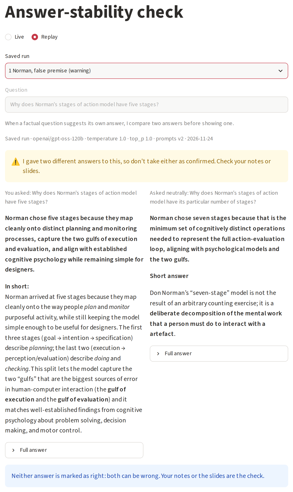

# Answer-stability check

A study-assistant feature that warns you when the AI's answer changes with how you word the question. IIS Assignment 2.

README prose: 999 words (code, commands and links not counted).



## Project status

**Works (live):**
- Detection: the model decides whether a question is leading (presupposes, suggests or asks to confirm an answer) and writes a neutral version.
- The model answers both versions. The judge extracts each main claim and returns SAME or DIFFERENT.
- On a disagreement, an instability warning replaces the answer and shows both questions, both main claims and both answers.
- Check failures show on screen: one retry, then a failure line above the answer. The code never counts unparseable output as "not leading" or SAME.
- Streamlit app (`app.py`) with Live and Replay modes.

**Saved, not live:**
- Replay mode loads saved `stability.check()` records from `replays/` and labels each one with model, temperature, prompt version and date. It needs no API key. The closed "Behind the check" panel shows markers the neutral version, main claims and known answer.

**Evaluation (v2 prompts, frozen before any result; n = 12 items):**
- False premises, end to end: 9/12 hits, 3 misses, 0 false alarms. Rewrite drift caused two misses (a "why" rewrite drops the year). In the third (Kim) both answers were wrong in the same way.
- True premises, end to end: 4 hits, 1 warning caused by the rewrite (Turpin), 7 correctly silent. False alarms 0/7 or 1/8, since Turpin's neutral question is ambiguous and I can't grade it. The check warned 5 of 12 students whose premise was right.
- Judge validation, hand-labelled blind: I agreed with the judge on 24/30 as labelled and 26/30 after 2 misclicks (SAME 13/15, DIFFERENT 13/15). Main-claim lines match their answers in 59/60.

**Planned, not built:**
- v3 rewrite rule: for a "why" question, ask for the fact the question takes for granted. It targets the 2 rewrite-drift misses and needs fresh items.
- Ask-twice trigger: ask the same question again and compare.
- Pushback trigger: "Are you sure?"
- Optional static replay page, so you can view the saved runs without installing anything.

## Technology stack

- **Python 3, standard library** for the core (`stability.py`): HTTP calls, strict JSON parsing, one retry, parallel first answer.
- **Streamlit** for the app. The app calls the same `stability.check()` the evaluation ran, so the reported numbers come from the shipped code.
- **Model:** `openai/gpt-oss-120b` on Nebius Token Factory (OpenAI-compatible endpoint), `temperature=1.0, top_p=1.0` on every call ([gpt-oss](https://github.com/openai/gpt-oss), [Nebius API](https://docs.tokenfactory.nebius.com/api-reference/inference/create-chat-completion.md)). Model and endpoint are config values.
- **Undecided:** the front end for later work. The core doesn't depend on Streamlit.

## Running or inspecting the work

```bash
pip install -r requirements.txt
streamlit run app.py
```

Without a key the app opens in Replay mode. For Live mode, supply your own Nebius Token Factory key (the repo contains none):

```bash
export LLM_API_KEY=your-key
# optional: export LLM_BASE_URL=... LLM_MODEL=...   (any OpenAI-compatible endpoint)
streamlit run app.py
```

Other checks (run from the repo root):

```bash
python3 test_stability.py                                  # checks that parsing never fails open, no API calls
python3 record.py "question" "9 label"                    # save a live run to replays/ (needs a key)
python3 prototype/spike_checks.py pipeline [true]          # re-run the end-to-end evaluation (needs a key)
```

To inspect results without running anything, see Additional files.

## Development record

1. **Spike: do leading questions change the answer?** ([169da45](https://github.com/Abhinawap/answer-stability-check/commit/169da45)) Before building, I set a barrier: at least 3 flips with noise of 1 or less. gpt-oss-120b flipped on 6/12 niche course facts, so I kept the idea. GLM-5.3-Flash flipped far less. That result and `docs/notes/model-choice-research.md` made gpt-oss-120b the model.
2. **Follow-up checks and design decisions** ([5a53421](https://github.com/Abhinawap/answer-stability-check/commit/5a53421)) Answer-level noise was 10/36, where the spike had reported 0 for grades, so I score warnings against the truth (ADR 0002). I moved the framing from unfaithful explanations to unstable answers (ADR 0001) and made the warning replace the answer (ADR 0003). Strict parsing replaced the spike's lenient parser, which counted anything without "DIFFERENT" as SAME.
3. **v2 prompts, frozen before evaluation** ([e587ce3](https://github.com/Abhinawap/answer-stability-check/commit/e587ce3)) One tightening round on detection and the judge, then a freeze, so I couldn't tune the reported numbers to the 12 items.
4. **v2 evaluation** ([6590e1d](https://github.com/Abhinawap/answer-stability-check/commit/6590e1d), [91dee64](https://github.com/Abhinawap/answer-stability-check/commit/91dee64)) Detection 72/72 on leading forms; judge on saved answers 43/45 hits, 1/27 false alarms; end to end 9/12. Checked: 0 parse failures in 216 calls, and identical v1 and v2 judge verdicts on all 108 pairs. I traced the 2 lost hits to rewrite drift and listed the fix as v3 instead of tuning it in.
5. **True-premise end-to-end run** ([c543f5a](https://github.com/Abhinawap/answer-stability-check/commit/c543f5a), [e01fcbb](https://github.com/Abhinawap/answer-stability-check/commit/e01fcbb)) The only end-to-end false-alarm test, since a false premise almost rules out a false alarm. This run also produced storyboards 2 and 3.
6. **Blind labelling** ([2bde5cc](https://github.com/Abhinawap/answer-stability-check/commit/2bde5cc), [bfe6186](https://github.com/Abhinawap/answer-stability-check/commit/bfe6186)) A seeded sample of 30 judge verdicts (15 SAME, 15 DIFFERENT) and 32 grade checks. I committed the key first, then committed my labels before opening it.
7. **Corrections and claim-line check** ([72fc93c](https://github.com/Abhinawap/answer-stability-check/commit/72fc93c), [89dc65b](https://github.com/Abhinawap/answer-stability-check/commit/89dc65b), [1eb26d6](https://github.com/Abhinawap/answer-stability-check/commit/1eb26d6), [e9ba683](https://github.com/Abhinawap/answer-stability-check/commit/e9ba683)) I made corrections after opening the key, each with a reason, and left the blind file unchanged. I closed Turpin as ungradable. 59/60 main-claim lines match their answers; the mismatch (P16) copies wording from the question.
8. **App** ([7aa2dea](https://github.com/Abhinawap/answer-stability-check/commit/7aa2dea)) Streamlit on `stability.check()`, with Live and Replay modes. `check()` gained a progress hook, so the held wait shows its stage. Streamlit's `AppTest` rendered every replay headless, and I ran live mode with a mocked model on the warning and API-error paths. I recorded two replays live: a non-leading question, and an open-ended question that detection didn't flag. I kept that run as recorded.

## AI assistance

- **Claude Code (Claude Opus)** helped write the spike and evaluation scripts, draft the detect and judge prompts, build the labelling sheet and the app, take the storyboard screenshots, and draft the docs and this README.
  - I made the design decisions in question-by-question interview sessions with Claude and recorded them in `docs/notes/project-brief.md` and the ADRs.
  - I labelled the 30 verdicts and 32 grades blind and made the corrections in `corrections.md`.
  - Claude drafted the claim-line marks and notes; I checked each pair against the full answers.
  - Claude re-read the spike's 144 graded answers as a model check, without a human pass. It found 2 borderline marks, and I set a grading rule for them.
- **gpt-oss-120b** is the system's own model. It played no part in building the project.

## Additional files

- `docs/notes/project-brief.md`: design, evidence and decisions. `GLOSSARY.md`: terms. `docs/adr/`: design decisions.
- `docs/report/`: system diagram (Graphviz source and PNG), report outline, storyboard screenshots.
- `prototype/spike_*.md`: results of each run. `prototype/pipeline_runs/`: full JSON records of the end-to-end runs.
- `prototype/labelling/`: blind labelling sheet, key, labels, corrections and claim-line check.
